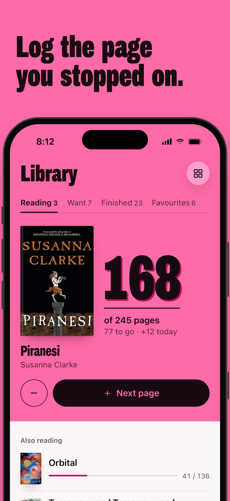
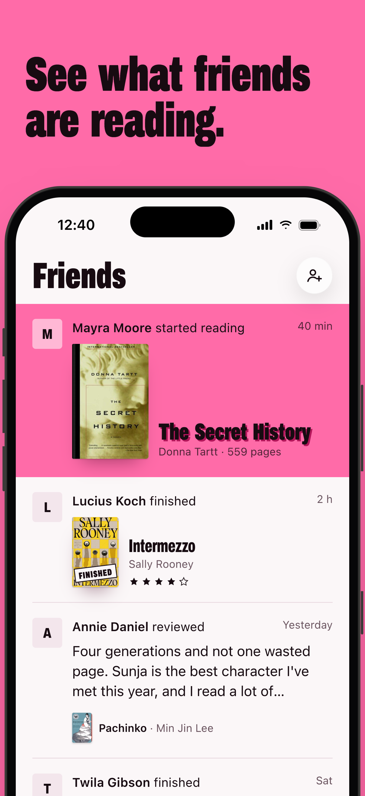
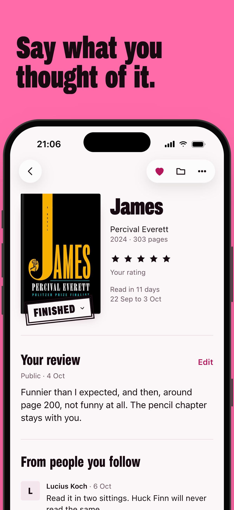
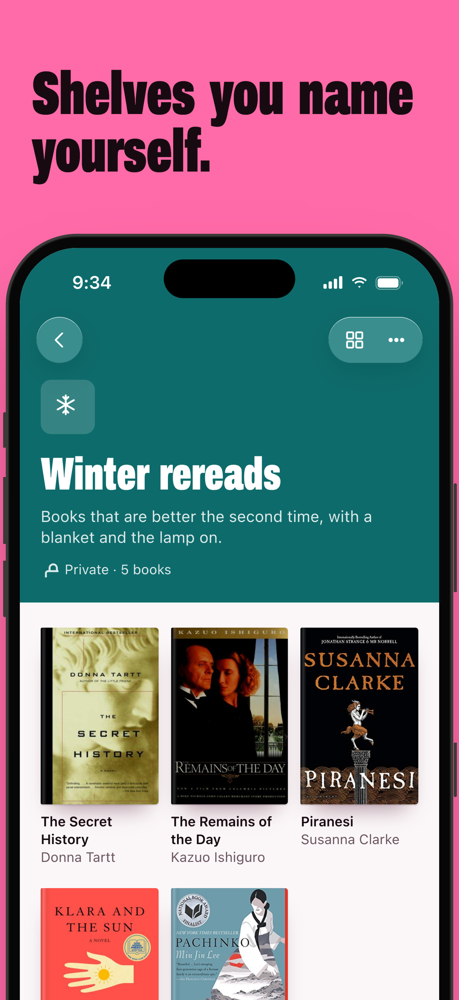
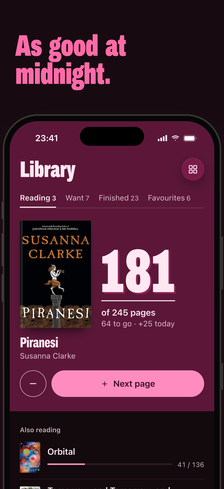

<div align="center">


# Echo

**A reading tracker for people who want to remember the books they read.**

Log the page you stopped on, stamp a book finished, and see what your friends are reading.
No ads, no feed trying to sell you something.

[](https://expo.dev)
[](https://reactnative.dev)
[](https://www.typescriptlang.org)
[](https://echoreads.app)

[**echoreads.app**](https://echoreads.app) · [Support](https://echoreads.app/support)

<br />







</div>

<br />

## ✨ What it does

- 📖 **Log where you stopped** — the book you're reading is the first thing you see. Tap *Next page* or drag the number like a numbering stamp.
- 🏁 **Finish it properly** — reach the last page and a FINISHED stamp lands on the cover. Rate it and write a public or private review.
- 📚 **Your shelves** — Reading, Want to read, Finished and Favourites, as a grid of covers or a list.
- 🔎 **Find any book** — search the Echo catalogue and Open Library, and add a book in one tap.
- 👋 **Friends** — follow other readers and see what they start, finish and review. Nothing ranked, nothing promoted.
- 🗂️ **Collections** *(Premium)* — your own named shelves with a colour, an icon and a cover. Keep them private or share them.
- 🌗 **Designed dark mode** — pink for what you're reading now, paper for everything else.

## 🧱 Built with

- [Expo](https://expo.dev) & Expo Router
- [Clerk](https://clerk.com) auth
- [TanStack Query](https://tanstack.com/query)
- [Zod](https://zod.dev)
- [Uniwind](https://uniwind.dev) styling
- Reanimated
- i18next

## 🚀 Getting started

### Prerequisites

- [Node.js](https://nodejs.org) (LTS) and [pnpm](https://pnpm.io)
- Xcode with an iOS Simulator, and/or Android Studio with an emulator

### 1. Install

```bash
pnpm install
```

### 2. Configure

Copy the example env file and fill in the values:

```bash
cp .env.example .env.local
```

| Variable | What it's for |
| --- | --- |
| `EXPO_PUBLIC_API_URL` | Backend API. Defaults to `https://echoreads.app/api`. For a local backend on the simulator use `http://localhost:3000/api` (a real phone needs your Mac's LAN IP). |
| `EXPO_PUBLIC_CLERK_PUBLISHABLE_KEY` | Clerk key that matches the backend you're pointing at. |
| `EXPO_PUBLIC_OPEN_LIBRARY_CONTACT` | Contact email sent to Open Library with search requests. |

> **Running the backend locally?** Start `pnpm dev` in the `echo` repo, then seed a test user with `pnpm db:seed:dev --email <your test user>`.

### 3. Run

```bash
pnpm ios       # iOS Simulator
pnpm android   # Android emulator
pnpm start     # Expo dev server only
```

## 📦 Building

```bash
pnpm build
```

An interactive script asks for the **platform** (iOS / Android), the **profile**, and whether to build **locally** or on **EAS**. Local builds land in `builds/`.

| Profile | Use it for |
| --- | --- |
| `development` | Dev client with debugging |
| `ios-simulator` | Simulator build (local only) |
| `preview` | Internal testing |
| `production` | App Store / Google Play |

Submit a finished build with `eas submit --platform ios` (or `android`).

## 🗺️ Project layout

```
src/
├── app/          # screens (Expo Router)
├── components/   # UI, with design-system primitives in echo/
├── hooks/        # React Query hooks
├── lib/          # API client, schemas, theme, storage
└── locales/      # translations
design/redesign/  # design spec, screenshots and store assets
```

For architecture and conventions, see [`CLAUDE.md`](CLAUDE.md) and [`design/redesign/`](design/redesign/).

<br />

<div align="center">
  <sub>Made for readers · <a href="https://echoreads.app">echoreads.app</a></sub>
</div>
